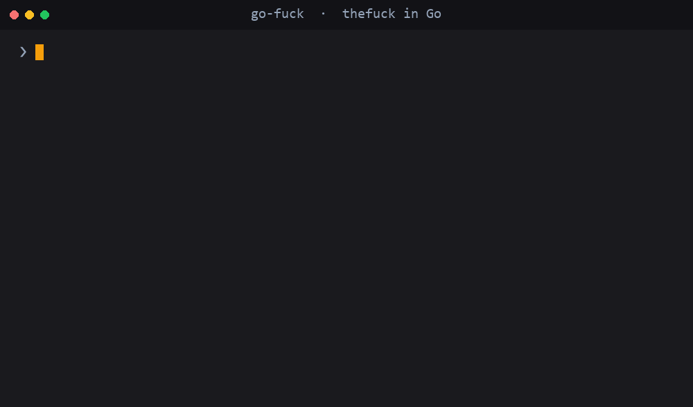
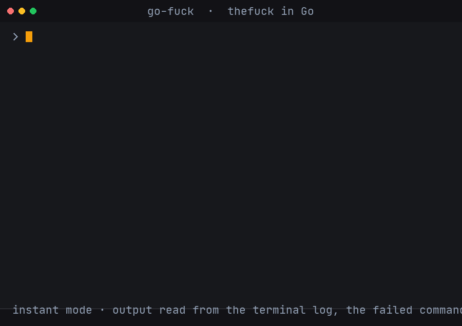

# go-fuck

[](https://github.com/leafevans/go-fuck/actions/workflows/ci.yml)
[](https://github.com/leafevans/go-fuck/actions/workflows/codeql.yml)
[](https://leafevans.github.io/go-fuck/)
[](https://pkg.go.dev/github.com/leafevans/go-fuck)
[](LICENSE)

A blazingly fast reimplementation of [thefuck](https://github.com/nvbn/thefuck) in Go.

**Project status:** go-fuck is stable as of **1.0.0**. The settings file and the `--json` output
are covered by compatibility guarantees (see [UPGRADING.md](UPGRADING.md)); the instant mode
remains opt-in.

`go-fuck` fixes the command you just typed and got wrong. Run the `fuck` alias after a failure and
go-fuck replays the command to capture its error output, matches a rule against it and executes the
corrected command once you confirm the suggestion.



```console
$ git push
fatal: The current branch main has no upstream branch.
To push the current branch and set the remote as upstream, use

    git push --set-upstream origin main

$ fuck
› git push --set-upstream origin main  [enter · ↑↓ · ctrl+c]
```

## Contents

1. [Why Go](#why-go)
2. [Features](#features)
3. [Requirements](#requirements)
4. [Installation](#installation)
5. [Shell setup](#shell-setup)
6. [First steps](#first-steps)
7. [How it works](#how-it-works)
8. [Instant mode](#instant-mode)
9. [Machine readable output](#machine-readable-output)
10. [Settings](#settings)
11. [Confirmation keys](#confirmation-keys)
12. [Rules](#rules)
13. [Creating custom rules](#creating-custom-rules)
14. [Differences from thefuck](#differences-from-thefuck)
15. [Contributing](#contributing)
16. [License](#license)
17. [Acknowledgements](#acknowledgements)

## Why Go

- **One static binary.** A single `go-fuck` executable (or `go-fuck.exe` on Windows) contains
  everything. No interpreter, no packages and no runtime dependencies.
- **Fast startup.** A native Go binary starts in milliseconds, without importing an interpreter and
  its modules.
- **Cross-platform by default.** The same source builds for Linux, macOS and Windows on amd64 and
  arm64, and CI builds and tests all three systems.
- **Small, dependency-free codebase.** Standard library only, formatted with `gofmt` and organized
  so a new rule is one file plus one test file.

### Benchmarks

The correction hot path and the shell history parser have Go benchmarks
(`make bench`); they do not depend on the installed tools. Measured on an AMD Ryzen 7 7730U (16 logical CPUs) with Go 1.26:

| Benchmark                                                          | Result      |
| ------------------------------------------------------------------ | ----------- |
| Full correction path (select rules, match them, order suggestions) | ~0.2 ms/op  |
| Matching every rule against a captured output                      | ~0.18 ms/op |
| Matching rules when the command output could not be captured       | ~1.4 µs/op  |
| Parsing a 20,000 line shell history file                           | ~1.3 ms/op  |

The rule engine adds roughly 0.2 ms; the wall clock time of a correction is
dominated by deliberately re-running the failed command. An interpreter based
implementation pays for interpreter and module import startup before the first
rule runs, which a native binary does not need.

## Features

- Shell integration for **bash**, **zsh**, **fish**, **tcsh** and **PowerShell**.
- Machine readable JSON output for editor plugins, scripts and AI agents with `--json`.
- Interactive confirmation prompt with keyboard navigation, or skip it with `-y`/`--yes`.
- Re-runs go-fuck when the corrected command fails with `-r`/`--repeat`; `--force-command` fixes an
  arbitrary command instead of the previous one.
- A single ember theme for the version banner, confirmation prompt, help text, setup messages and
  diagnostics: shared `›`/`×`/`·` symbols, an fzf prompt in the same palette, 24 bit, 256 color and
  16 color fallbacks, and `NO_COLOR` support.
- A JSON settings file with defaults for every option, environment variable overrides using the
  `GOFUCK_*` prefix and the legacy `THEFUCK_*` prefix, rule priorities, disabled rules and
  per-rule settings.
- Custom rules as compiled Go rules or declarative JSON files in the configuration directory.

## Requirements

- **Go 1.23 or newer** to build from source. Go 1.22 and older do not emit the `LC_UUID` load
  command that macOS 26 requires for binaries that use networking (golang/go#68678), so the macOS
  binaries built with them refuse to start; use a current toolchain.
- **No runtime dependencies.** The compiled binary is self-contained.
- A supported shell for the alias: bash, zsh, fish, tcsh or PowerShell. On Windows, PowerShell is
  recommended; a `cmd.exe` shim is provided as well.

## Installation

### With Homebrew (macOS and Linux)

The repository doubles as a Homebrew tap:

```bash
brew tap leafevans/go-fuck https://github.com/leafevans/go-fuck
brew trust leafevans/go-fuck
brew install go-fuck
```

The formula installs the prebuilt binary for your platform, so no Go toolchain is
needed. Upgrade with `brew upgrade go-fuck`.

### With Scoop (Windows)

```powershell
scoop bucket add go-fuck https://github.com/leafevans/go-fuck
scoop install go-fuck
```

Upgrade with `scoop update go-fuck`.

### With the AUR (Arch Linux)

The package is in the [Arch User Repository](https://aur.archlinux.org/packages/go-fuck) and builds
from source:

```bash
yay -S go-fuck        # or: paru -S go-fuck
```

Or install it manually with `makepkg`:

```bash
git clone https://aur.archlinux.org/go-fuck.git
cd go-fuck
makepkg -si
```

Upgrade it with your AUR helper (`yay -Syu` or `paru -Syu`). The AUR package
targets x86_64; on other architectures use `go install` or the prebuilt binaries.

### With `go install`

```bash
go install github.com/leafevans/go-fuck/cmd/go-fuck@latest
```

The binary is installed into `$(go env GOPATH)/bin` (`%USERPROFILE%\go\bin` on Windows). Make
sure that directory is on your `PATH`.

### Prebuilt binaries

Download the archive for your operating system and architecture from the
[releases page](https://github.com/leafevans/go-fuck/releases), unpack it and place the `go-fuck`
binary somewhere on your `PATH`. Linux and macOS archives contain the raw binary, Windows archives
contain `go-fuck.exe`. Every release ships a `checksums.txt` file that you can use to verify the
download.

### From source

```bash
git clone https://github.com/leafevans/go-fuck.git
cd go-fuck
make build          # or: go build -o go-fuck ./cmd/go-fuck
```

`make install` runs `go install ./cmd/go-fuck` instead. On Windows the build produces
`go-fuck.exe`.

## Shell setup

go-fuck is a normal executable; the alias function connects it to the previous command and evaluates
the corrected command that go-fuck prints. `go-fuck --alias` generates the function for the detected
shell, so the setup is the same everywhere and always matches the installed binary.

### Automatic setup

`go-fuck --setup` writes the alias line to the detected shell's configuration file and prints the
command that reloads it. Running it again is safe: when the line is already present go-fuck reports
that the shell is already configured and leaves the file untouched.

Pass `--enable-experimental-instant-mode` to configure [instant mode](#instant-mode)
instead of the regular alias; shells without instant mode support warn and fall back to the regular
alias.

bash, zsh, fish and tcsh are configured when their configuration file already exists. PowerShell is
configured for every installed flavor: go-fuck asks `powershell.exe` and `pwsh` for their
`$PROFILE` (the Documents folder can be redirected, for example to OneDrive) and creates the profile
file when it is missing.

### Manual setup

Add the line for your shell to its configuration file, then start a new shell or reload the file:

```console
# bash: ~/.bashrc (or ~/.bash_profile on macOS)
# zsh:  ~/.zshrc
eval "$(go-fuck --alias)"

# fish: ~/.config/fish/config.fish
go-fuck --alias | source

# tcsh: ~/.tcshrc
eval `go-fuck --alias`

# PowerShell: $PROFILE
iex "$(go-fuck --alias)"
```

go-fuck detects the shell from `TF_SHELL` and otherwise from the process tree. If detection is
unreliable, for example when generating the alias from a setup script, set it explicitly:
`TF_SHELL=fish go-fuck --alias`.

### Custom alias name

Pass the name after `--alias`:

```bash
eval "$(go-fuck --alias FUCK)"
```

The name has to be a valid shell function name. Without an argument, the alias is named after the
`TF_ALIAS` environment variable when it is set, and `fuck` otherwise.

### How the alias works

The generated function exports a few variables, calls go-fuck and evaluates the corrected command that
go-fuck prints on standard output:

| Variable                      | Set by                 | Purpose                                                                                                                                  |
| ----------------------------- | ---------------------- | ---------------------------------------------------------------------------------------------------------------------------------------- |
| `TF_SHELL`                    | the alias              | shell name (`bash`, `zsh`, `fish`, `tcsh`, `powershell`); go-fuck uses it instead of guessing from the process tree                      |
| `TF_ALIAS`                    | the alias              | name of the alias function; used in messages and by the repeat mechanism                                                                 |
| `TF_HISTORY`                  | the bash and zsh alias | the last ten history lines; go-fuck picks the failed command from them                                                                   |
| `TF_SHELL_ALIASES`            | the bash and zsh alias | the shell aliases, expanded before the command is matched                                                                                |
| `GOFUCK_ARGUMENT_PLACEHOLDER` | the alias              | separates go-fuck's own arguments from the arguments of the corrected command; the legacy `THEFUCK_ARGUMENT_PLACEHOLDER` is accepted too |

The fish alias passes the previous command explicitly via its `$history[1]` variable. Because
`TF_SHELL` is always set by the alias, go-fuck uses the right shell-specific behavior even when the
process tree is unreliable (containers, `sudo`, wrappers).

### Windows: cmd.exe and PowerShell shims

The `scripts/` directory contains two small Windows shims that mirror the scripts shipped with
thefuck:

- `scripts/fuck.bat` — for `cmd.exe`. It passes the previous command from the doskey history to
  go-fuck and runs the corrected command in the current console.
- `scripts/fuck.ps1` — for PowerShell. The first call writes the go-fuck initialization to your
  profile and defines `fuck()` for the current session; later calls delegate to the function.

Put the script somewhere on your `PATH` and call `fuck`. The release archives of every platform
ship both shims in their `scripts/` directory.

## First steps

The introduction shows a git correction. Two more examples:

```console
$ cd project/src
cd: no such file or directory: project/src

$ fuck
› mkdir -p project/src && cd project/src  [enter · ↑↓ · ctrl+c]
```

```console
$ echo "hello'
zsh: unmatched "

$ fuck
› echo "hello"  [enter · ↑↓ · ctrl+c]
```

Common options:

| Option                               | Meaning                                                                                                                                                          |
| ------------------------------------ | ---------------------------------------------------------------------------------------------------------------------------------------------------------------- |
| `-y`, `--yes`, `--yeah`, `--hard`    | execute the first suggestion without asking                                                                                                                      |
| `-r`, `--repeat`                     | re-run go-fuck if the corrected command fails                                                                                                                    |
| `--force-command CMD`                | fix `CMD` instead of the previous command                                                                                                                        |
| `--doctor`                           | print a diagnostic report: detected shell, alias, settings file, history and optional integrations; `--doctor --json` prints it as JSON                          |
| `--list-rules`                       | print the names of the built-in rules and exit (useful for the `rules`, `exclude_rules` and `priority` settings)                                                  |
| `--json`                             | print the suggestions as JSON and exit (useful for scripts and editors; call go-fuck directly rather than through the alias)                                     |
| `-d`, `--debug`                      | print debug information to stderr                                                                                                                                |
| `-v`, `--version`                    | print version/build information: a themed banner in a terminal, one line when piped; `--debug --version` adds the config path, instant mode, fzf and alias state |
| `-h`, `--help`                       | print the full option list                                                                                                                                       |
| `--setup`                            | write the alias to the detected shell's configuration file (bash, zsh, fish, tcsh, PowerShell)                                                                   |
| `--enable-experimental-instant-mode` | alias initialization flag: with `--alias` or `--setup`, configure the instant mode (bash/zsh on Linux and macOS, PowerShell on Windows)             |

### Troubleshooting

If `fuck` does nothing, or go-fuck cannot find the command that failed, run the diagnostic report:

```console
$ go-fuck --doctor
```

It checks the detected shell, the alias in the shell configuration file, the settings file, the
command history and the optional integrations (fzf and instant mode). For instant mode it validates
the logged shell's terminal log and warns when the instant mode line is no longer the last prompt
definition in the PowerShell profile. Warnings include the command that fixes them, and
`--doctor --json` prints the same report as JSON.

To list the rule names accepted by the `rules`, `exclude_rules` and `priority` settings, run:

```console
$ go-fuck --list-rules
```

## How it works

1. You run a command and it fails. You type `fuck`.
2. The shell function exports the shell name and history and calls `go-fuck`.
3. go-fuck determines the command that failed, expands shell aliases and **re-runs the command**
   with a short timeout (`wait_command`, three seconds by default; commands listed in
   `slow_commands` get `wait_slow_command`, fifteen seconds by default) to capture its output.
   Instant mode skips this step and reads the output from the terminal log instead.
4. Every enabled rule is tried in priority order. A matching rule returns one or more corrected
   commands, which are sorted by priority and offered in the confirmation prompt.
5. When you accept a suggestion, go-fuck applies the rule's side effect (if any), optionally writes
   the corrected command to the shell history and prints it on standard output.
6. The shell function evaluates that output, so the corrected command runs in your shell exactly as
   if you had typed it.

The re-run is why the default mode works with any shell and any command without a terminal logger;
the cost is running the failed command a second time, which is what instant mode avoids.

On Windows the command is re-run with the PowerShell flavor that started go-fuck, so PowerShell
native commands and syntax produce their real error messages instead of an unrelated cmd.exe
"not recognized" error. Processes that were not started from PowerShell, and processes whose alias
does not report the shell through `GOFUCK_SHELL`, keep the cmd.exe behavior.

## Instant mode

Instant mode reads the output of the previous command from a terminal log instead
of re-running the command. This is useful for slow, interactive or side effecting commands. It is
implemented for **bash and zsh on Linux and macOS** and for **PowerShell on Windows**; other shells
and platforms warn and fall back to the regular alias.



Enable it by passing the instant mode flag to the alias initialization in your shell configuration.
On bash, zsh and Windows PowerShell `go-fuck --setup --enable-experimental-instant-mode` writes that
line to your configuration file for you.

Linux and macOS:

```bash
# ~/.bashrc (or ~/.zshrc for zsh)
eval "$(go-fuck --alias --enable-experimental-instant-mode)"
```

Windows (Windows PowerShell 5.1 and PowerShell 7):

```powershell
# $PROFILE
iex "$(go-fuck --alias --enable-experimental-instant-mode)"
```

The flag name contains `experimental` for historical reasons.

Restart the shell. The initialization replaces the terminal shell with a logged subshell: commands
keep working as usual, but go-fuck reads their output from the terminal log, so `fuck` does not
execute the failed command a second time. The log is a temporary file that is removed when the
logged shell exits.

On Windows the logged shell runs on a pseudo console (ConPTY), which requires Windows 10 version
1809 or newer. When ConPTY is not available, the regular alias is installed instead of closing the
terminal.

The mode is covered by end-to-end tests: an interactive bash runs on a pseudo terminal on Linux and
macOS, and Windows PowerShell runs on a pseudo console on Windows; the tests feed a command, check
the terminal log and read the output back. Multi line commands, such as PSReadLine's Shift+Enter
input, are matched line by line. When instant mode is enabled, `go-fuck --doctor` also validates the
active terminal log (readable, not empty, prompt marker present).

Limitations:

- The shell profile runs twice per terminal start: once in the terminal shell and once in the
  logged subshell. Slow profiles delay the first prompt twice.
- Prompt frameworks that rebuild `PS1` before every prompt (starship, powerlevel10k, ...) keep
  working, because the marker is re-added after the prompt functions run. A prompt definition added
  after the instant mode line can still hide the marker; on Windows the instant mode line has to be
  the last prompt definition in the profile.
- Full screen programs such as `vim` or `tmux` use the alternate screen, whose content is not
  part of the log; the previous screen is restored when they exit. If the terminal is closed while
  such a program is still running, the end of the log may be missing.
- On Windows the terminal size is polled, so a resized window reaches the logged shell with a short
  delay.
- The log keeps the newest 1 MiB of terminal output. The renderer is simpler than the reference
  implementation's pyte emulation: ANSI stripping and carriage return overwrites on Linux and macOS,
  a small screen model for the ConPTY stream on Windows, so full screen programs can still differ.

The logged shell exports `GOFUCK_INSTANT_MODE=true`, which enables the `instant_mode` setting
automatically; there is no need to set it manually.

## Machine readable output

`--json` prints the correction result as JSON instead of opening the interactive prompt. It is
intended for editor plugins, scripts and AI agents; call go-fuck directly rather than through the
shell alias, because the alias evaluates whatever go-fuck prints.

```console
$ go-fuck --json --force-command "git brnch"
{
  "schema_version": 1,
  "command": "git brnch",
  "suggestions": [
    {
      "command": "git branch",
      "priority": 1000,
      "side_effect": false
    },
    {
      "command": "git brnch",
      "priority": 5000,
      "side_effect": false
    }
  ]
}
```

The suggestions are ordered as they would be offered interactively. `priority` is the rule
priority (lower values are tried first). `side_effect` reports whether the interactive mode would
run a side effect, for example `git add`, before the corrected command. The history rule can repeat
the original command as a fallback suggestion; consumers that only want real corrections can skip
suggestions equal to `command`.

`output` is the captured standard output and standard error of the failed command; it is omitted
when the output could not be captured. Output larger than 32 KiB is cut at a UTF-8 boundary and
`output_truncated` is set to `true`. The example above omits the `output` field for brevity.

In JSON mode go-fuck does not execute the corrected command, does not apply side effects and does
not update the shell history; the caller decides what to do with the suggestions. The exit code is
0 once the JSON was written, even when no rule matched and `suggestions` is empty.

The JSON document is a stable machine readable contract. `schema_version` is `1` for the whole
1.x series; it is only incremented for a breaking layout change, while new optional fields may be
added in minor releases. Consumers must ignore unknown fields and must not rely on the key order.
The document is always written to stdout; diagnostics stay on stderr.

## Settings

Settings are stored in `settings.json` inside the go-fuck directory of the user configuration
directory returned by Go's `os.UserConfigDir()`:

| Operating system | Path                                                                            |
| ---------------- | ------------------------------------------------------------------------------- |
| Linux / BSD      | `~/.config/go-fuck/settings.json` (or `$XDG_CONFIG_HOME/go-fuck/settings.json`) |
| macOS            | `~/Library/Application Support/go-fuck/settings.json`                           |
| Windows          | `%AppData%\go-fuck\settings.json`                                               |

The file is created with the default settings on first use. JSON does not support comments, so the
generated file contains an explanatory `_comment` field; it is ignored when the file is loaded.

Unknown keys are ignored, so a settings file written by a newer go-fuck keeps working with an older
one. Invalid JSON or a value of the wrong type is reported and the file is not applied, so go-fuck
falls back to the built-in defaults instead of running with a half applied configuration. From 1.0.0
the keys above and their meaning are frozen; new optional keys may be added in minor releases.

A minimal file that customizes a few values:

```json
{
    "rules": ["All rules enabled"],
    "exclude_rules": ["git_push"],
    "wait_command": 10,
    "require_confirmation": true,
    "priority": {
        "cd_mkdir": 100
    },
    "settings": {}
}
```

All fields:

| Key                             | Type              | Default                                                      | Meaning                                                                                                                                                                                       |
| ------------------------------- | ----------------- | ------------------------------------------------------------ | --------------------------------------------------------------------------------------------------------------------------------------------------------------------------------------------- |
| `rules`                         | array of strings  | `["All rules enabled"]`                                      | Rules that are enabled. The sentinel value `"All rules enabled"` enables every rule that is enabled by default; list explicit rule names to enable exactly those rules.                       |
| `exclude_rules`                 | array of strings  | `[]`                                                         | Rules that are never loaded, even when enabled.                                                                                                                                               |
| `wait_command`                  | integer           | `3`                                                          | Seconds to wait for the output of the re-run command.                                                                                                                                         |
| `require_confirmation`          | boolean           | `true`                                                       | Ask before executing a corrected command.                                                                                                                                                     |
| `fzf`                           | boolean           | `false`                                                      | Use [fzf](https://github.com/junegunn/fzf) as the selection prompt when it is installed. Falls back to the built-in prompt automatically.                                                     |
| `no_colors`                     | boolean           | `false`                                                      | Disable colored output.                                                                                                                                                                       |
| `debug`                         | boolean           | `false`                                                      | Print debug information to stderr.                                                                                                                                                            |
| `priority`                      | object of integer | `{}`                                                         | Per-rule priority overrides. Lower values are tried first; the built-in default is `1000`.                                                                                                    |
| `history_limit`                 | integer           | `0`                                                          | Maximum number of shell history lines that are read. `0` means no limit.                                                                                                                      |
| `alter_history`                 | boolean           | `true`                                                       | Write the corrected command back to the shell history.                                                                                                                                        |
| `wait_slow_command`             | integer           | `15`                                                         | Seconds to wait for the output of commands listed in `slow_commands`.                                                                                                                         |
| `slow_commands`                 | array of strings  | `["lein", "react-native", "gradle", "./gradlew", "vagrant"]` | Commands that are expected to be slow to re-run.                                                                                                                                              |
| `repeat`                        | boolean           | `false`                                                      | If the corrected command fails, run go-fuck again.                                                                                                                                            |
| `instant_mode`                  | boolean           | `false`                                                      | Inside the logged shell, read the previous output from the terminal log instead of re-running the command; the instant mode alias sets this automatically. See [Instant mode](#instant-mode). |
| `num_close_matches`             | integer           | `3`                                                          | Maximum number of close matches suggested for misspelled commands.                                                                                                                            |
| `env`                           | object of string  | `{"LC_ALL": "C", "LANG": "C", "GIT_TRACE": "1"}`             | Environment variables added when the failed command is re-run.                                                                                                                                |
| `excluded_search_path_prefixes` | array of strings  | `[]`                                                         | `PATH` prefixes that are skipped when searching for executables.                                                                                                                              |
| `settings`                      | object            | `{} in the default file`                                     | Rule-specific string settings, read by rules with `conf.Current().String(key, default)`.                                                                                                      |

### Environment variables

Every setting can be set with an environment variable. The modern prefix is `GOFUCK_`; the legacy
`THEFUCK_` prefix from the original implementation is still recognized, so an existing thefuck
configuration keeps working. For example, `GOFUCK_WAIT_COMMAND=10` and
`THEFUCK_WAIT_COMMAND=10` do the same thing. If both prefixes are set for the same setting, the
legacy `THEFUCK_*` variable is applied last and wins.

| Suffix                          | Type                                     | Example                                        | Corresponding setting                                               |
| ------------------------------- | ---------------------------------------- | ---------------------------------------------- | ------------------------------------------------------------------- |
| `RULES`                         | colon separated list                     | `GOFUCK_RULES='sudo:no_command'`               | `rules`; the token `DEFAULT_RULES` stands for `"All rules enabled"` |
| `EXCLUDE_RULES`                 | colon separated list                     | `GOFUCK_EXCLUDE_RULES='git_push'`              | `exclude_rules`                                                     |
| `WAIT_COMMAND`                  | integer seconds                          | `GOFUCK_WAIT_COMMAND=10`                       | `wait_command`                                                      |
| `REQUIRE_CONFIRMATION`          | boolean                                  | `GOFUCK_REQUIRE_CONFIRMATION=false`            | `require_confirmation`                                              |
| `FZF`                           | boolean                                  | `GOFUCK_FZF=true`                              | `fzf`                                                               |
| `NO_COLORS`                     | boolean                                  | `GOFUCK_NO_COLORS=true`                        | `no_colors`                                                         |
| `DEBUG`                         | boolean                                  | `GOFUCK_DEBUG=true`                            | `debug`                                                             |
| `PRIORITY`                      | `rule=priority` list separated by colons | `GOFUCK_PRIORITY='cd_mkdir=100:git_push=900'`  | `priority`                                                          |
| `HISTORY_LIMIT`                 | integer                                  | `GOFUCK_HISTORY_LIMIT=2000`                    | `history_limit`                                                     |
| `ALTER_HISTORY`                 | boolean                                  | `GOFUCK_ALTER_HISTORY=false`                   | `alter_history`                                                     |
| `WAIT_SLOW_COMMAND`             | integer seconds                          | `GOFUCK_WAIT_SLOW_COMMAND=30`                  | `wait_slow_command`                                                 |
| `SLOW_COMMANDS`                 | colon separated list                     | `GOFUCK_SLOW_COMMANDS='lein:gradle'`           | `slow_commands`                                                     |
| `REPEAT`                        | boolean                                  | `GOFUCK_REPEAT=true`                           | `repeat`                                                            |
| `INSTANT_MODE`                  | boolean                                  | `GOFUCK_INSTANT_MODE=false`                    | `instant_mode`                                                      |
| `NUM_CLOSE_MATCHES`             | integer                                  | `GOFUCK_NUM_CLOSE_MATCHES=5`                   | `num_close_matches`                                                 |
| `EXCLUDED_SEARCH_PATH_PREFIXES` | list separated by the OS path list separator (`:` on Linux/macOS, `;` on Windows) | `GOFUCK_EXCLUDED_SEARCH_PATH_PREFIXES='/snap:/mnt'` (Linux/macOS), `'C:\\Tools;C:\\Other'` (Windows) | `excluded_search_path_prefixes` |

The `env` map can only be set in `settings.json`. Booleans accept `true` and `false`
(case-insensitive).

Settings are applied in increasing order of precedence:

1. built-in defaults,
2. `settings.json`,
3. environment variables,
4. command line options such as `-y`, `-d` and `-r`.

## Confirmation keys

By default go-fuck asks before running the corrected command. The prompt shows the suggestion and the
available actions:

| Key                     | Action                         |
| ----------------------- | ------------------------------ |
| `Enter`                 | execute the selected command   |
| `↑`, `Ctrl+N`, `k`, `e` | select the previous suggestion |
| `↓`, `Ctrl+P`, `j`, `n` | select the next suggestion     |
| `Ctrl+C`, `q`           | abort without running anything |

Disable the prompt with `require_confirmation: false` in `settings.json` or by passing `-y`.

### fzf integration

If [fzf](https://github.com/junegunn/fzf) is installed, go-fuck can use it as the selection prompt.
Enable it once in `settings.json`:

```json
{
    "fzf": true
}
```

or per shell with `export GOFUCK_FZF=true`. When fzf runs, the suggestions are listed with a
`fuck>` prompt (`Enter` selects, `Esc` aborts); go-fuck falls back to its built-in prompt
automatically when fzf is not installed or fails. `-y`/`require_confirmation: false` still skips
the selection entirely.

## Rules

The built-in rules are compiled into the binary, and declarative JSON rules can be loaded from the
configuration directory (see [Creating custom rules](#creating-custom-rules)). Each rule decides
whether it applies to a failed command and returns one or more corrected commands. There are 239
built-in rules: 169 ported from the reference implementation plus 70 go-fuck specific rules for
failures that thefuck does not handle, including the GitHub and GitLab CLIs, kubectl/kind/kustomize,
uv, cargo, Helm, pnpm, the npm, pnpm, yarn and uv lock file checks, the Go toolchain and go.sum,
Node.js, bun, Deno, Docker Compose, just, Poetry, make, the go-task runner, minikube, Bundler,
Chocolatey, the .NET CLI, rustup toolchains, the Dart and Flutter command-line tools, the uv and Cargo
project setup corrections, the PowerShell file operation and cmd.exe corrections, git switch and safe.directory corrections and divergent, clobbered or blocked
git operations. The list below is generated from the compiled rules:

<!-- RULES_LIST_START -->
- `adb_unknown_command`
- `ag_literal`
- `apt_get`
- `apt_get_search`
- `apt_invalid_operation`
- `apt_list_upgradable`
- `apt_upgrade`
- `aws_cli`
- `az_cli`
- `brew_cask_dependency`
- `brew_install`
- `brew_link`
- `brew_reinstall`
- `brew_uninstall`
- `brew_unknown_command`
- `brew_update_formula`
- `bun_script_not_found`
- `bundle_unknown_command`
- `cargo`
- `cargo_missing_bench_target`
- `cargo_missing_bin`
- `cargo_missing_example_target`
- `cargo_missing_manifest`
- `cargo_missing_test_target`
- `cargo_no_command`
- `cargo_unknown_argument`
- `cargo_unknown_command`
- `cat_dir`
- `cd_correction`
- `cd_cs`
- `cd_mkdir`
- `cd_parent`
- `chmod_x`
- `choco_install`
- `choco_unknown_command`
- `cmd_cd_mkdir`
- `cmd_missing_directory`
- `cmd_missing_file`
- `cmd_mkdir_existing`
- `cmd_pushd_mkdir`
- `cmd_rmdir_nonempty`
- `composer_not_command`
- `conda_mistype`
- `cp_create_destination`
- `cp_omitting_directory`
- `cpp11`
- `dart_unknown_command`
- `deno_task_not_found`
- `dirty_untar`
- `dirty_unzip`
- `django_south_ghost`
- `django_south_merge`
- `dnf_no_such_command`
- `docker_compose_unknown_service`
- `docker_image_being_used_by_container`
- `docker_login`
- `docker_not_command`
- `dotnet_unknown_argument`
- `dotnet_unknown_command`
- `dry`
- `fab_command_not_found`
- `fix_alt_space`
- `fix_file`
- `flutter_unknown_command`
- `gem_unknown_command`
- `gh_unknown_command`
- `gh_unknown_flag`
- `git_add`
- `git_add_force`
- `git_amend_initial_commit`
- `git_bisect_usage`
- `git_branch_0flag`
- `git_branch_delete`
- `git_branch_delete_checked_out`
- `git_branch_exists`
- `git_branch_list`
- `git_checkout`
- `git_checkout_unstaged`
- `git_clone_git_clone`
- `git_clone_missing`
- `git_commit_add`
- `git_commit_amend`
- `git_commit_reset`
- `git_diff_no_index`
- `git_diff_staged`
- `git_dubious_ownership`
- `git_fetch_clobber_tag`
- `git_fix_stash`
- `git_flag_after_filename`
- `git_help_aliased`
- `git_hook_bypass`
- `git_lfs_mistype`
- `git_main_master`
- `git_merge`
- `git_merge_unrelated`
- `git_merge_unstaged`
- `git_not_command`
- `git_pull`
- `git_pull_clone`
- `git_pull_divergent`
- `git_pull_uncommitted_changes`
- `git_push`
- `git_push_different_branch_names`
- `git_push_force`
- `git_push_pull`
- `git_push_without_commits`
- `git_rebase_merge_dir`
- `git_rebase_no_changes`
- `git_rebase_unstaged`
- `git_remote_delete`
- `git_remote_seturl_add`
- `git_rm_local_modifications`
- `git_rm_recursive`
- `git_rm_staged`
- `git_stash`
- `git_stash_pop`
- `git_switch_existing_branch`
- `git_switch_unknown_branch`
- `git_tag_force`
- `git_two_dashes`
- `glab_unknown_command`
- `go_install_version`
- `go_missing_module`
- `go_missing_package`
- `go_missing_sum`
- `go_mod_init`
- `go_run`
- `go_unknown_command`
- `go_unknown_flag`
- `gradle_no_task`
- `gradle_wrapper`
- `grep_arguments_order`
- `grep_recursive`
- `grunt_task_not_found`
- `gulp_not_task`
- `has_exists_script`
- `helm_unknown_command`
- `heroku_multiple_apps`
- `heroku_not_command`
- `history`
- `hostscli`
- `ifconfig_device_not_found`
- `java`
- `javac`
- `just_unknown_recipe`
- `kind_unknown_command`
- `kubectl_unknown_command`
- `kustomize_unknown_command`
- `lein_not_task`
- `ln_no_hard_link`
- `ln_s_order`
- `long_form_help`
- `ls_all`
- `ls_lah`
- `make_unknown_target`
- `man`
- `man_no_space`
- `mercurial`
- `minikube_unknown_command`
- `missing_space_before_subcommand`
- `mkdir_p`
- `mvn_no_command`
- `mvn_unknown_lifecycle_phase`
- `nixos_cmd_not_found`
- `no_command`
- `no_such_file`
- `node_missing_module`
- `node_script_not_found`
- `npm_ci_lock_mismatch`
- `npm_ci_missing_lockfile`
- `npm_missing_script`
- `npm_peer_dependency_conflict`
- `npm_run_script`
- `npm_wrong_command`
- `omnienv_no_such_command`
- `open`
- `pacman`
- `pacman_invalid_option`
- `pacman_not_found`
- `path_from_history`
- `php_s`
- `pip_install`
- `pip_unknown_command`
- `pnpm_command_not_found`
- `pnpm_frozen_lockfile`
- `poetry_unknown_command`
- `port_already_in_use`
- `powershell_cd_unquoted_path`
- `powershell_missing_directory`
- `powershell_mkdir_existing`
- `powershell_remove_recurse`
- `powershell_set_location`
- `prove_recursively`
- `python_command`
- `python_execute`
- `python_module_error`
- `quotation_marks`
- `rails_migrations_pending`
- `react_native_command_unrecognized`
- `remove_shell_prompt_literal`
- `remove_trailing_cedilla`
- `rm_dir`
- `rm_root`
- `rustup_toolchain_missing`
- `rustup_unknown_subcommand`
- `scm_correction`
- `sed_unterminated_s`
- `sl_ls`
- `ssh_known_hosts`
- `sudo`
- `sudo_command_from_user_path`
- `switch_lang`
- `systemctl`
- `task_unknown_task`
- `terraform_init`
- `terraform_no_command`
- `test.py`
- `tmux`
- `touch`
- `tsuru_login`
- `tsuru_not_command`
- `unknown_command`
- `unsudo`
- `uv_locked_lockfile`
- `uv_missing_project`
- `uv_pip_no_venv`
- `uv_script_not_found`
- `uv_unknown_argument`
- `uv_unknown_subcommand`
- `vagrant_up`
- `whois`
- `workon_doesnt_exists`
- `wrong_hyphen_before_subcommand`
- `yarn_alias`
- `yarn_command_not_found`
- `yarn_command_replaced`
- `yarn_frozen_lockfile`
- `yarn_help`
- `yum_invalid_operation`
<!-- RULES_LIST_END -->

Regenerate it after adding or renaming a rule:

```bash
go run ./tools/gen-rule-list   # or: make rules-list
make rules-list-check          # fail when README.md is out of date
```

The same names can be used in the `rules`, `exclude_rules` and `priority` settings.

## Creating custom rules

There are two ways to add a rule.

### JSON rules (no rebuild)

go-fuck loads extra rules from JSON files in the `rules` directory inside its configuration
directory:

| Operating system | Directory                                                       |
| ---------------- | --------------------------------------------------------------- |
| Linux / BSD      | `~/.config/go-fuck/rules` (or `$XDG_CONFIG_HOME/go-fuck/rules`) |
| macOS            | `~/Library/Application Support/go-fuck/rules`                   |
| Windows          | `%AppData%\go-fuck\rules`                                       |

Each file contains one rule:

```json
{
    "name": "git_remote_typo",
    "enabled": true,
    "priority": 900,
    "match": {
        "script": "^git remote add (\\w+)$",
        "output": "No such remote '([^']+)'"
    },
    "commands": ["git remote remove {1}"]
}
```

- `name` is required, must match `^[a-z0-9][a-z0-9_.]*$` and must not collide with a built-in rule.
- `match.script` and `match.output` are regular expressions; at least one is required. When
  `match.output` is present the command output must be available, otherwise the rule is skipped.
- `commands` contains the suggested corrections. `{0}`, `{1}`, ... are replaced with the capture
  groups of `match.output`; `{script}` is replaced with the original command line.
- `enabled` (default `true`) and `priority` (default `1000`) behave like the flags of built-in
  rules and can be overridden with the `rules`, `exclude_rules` and `priority` settings.

The directory is read on every invocation, so a new rule is active the next time you run `fuck`;
no restart or rebuild is needed. Rules are purely declarative: they cannot run commands as side
effects or access the network. Invalid files are reported on stderr and skipped without affecting
the built-in rules.

### Compiled-in rules

Adding a rule to the binary still follows the porting workflow:

1. Read [PORTING.md](PORTING.md). It describes the rule interface, the helpers and the conventions.
2. Create `internal/rules/<rule_name>.go` and `internal/rules/<rule_name>_test.go`, port the test
   cases from thefuck and register the rule from an `init` function.
3. Run the checks described in [CONTRIBUTING.md](CONTRIBUTING.md).
4. Regenerate the rule list in this file with `make rules-list`.

JSON rules are the lightweight option for local and machine specific corrections; compiled-in rules
are the right place for generally useful rules and for rules that need to inspect files or run
external commands.

## Differences from thefuck

go-fuck is a reimplementation, not a drop-in replacement for every thefuck feature:

- **Complete rule port plus extras.** All 169 rules of the reference implementation are ported,
  plus 70 go-fuck specific rules; the list in [Rules](#rules) is authoritative. Porting conventions
  are documented in [PORTING.md](PORTING.md).
- **Instant mode covers Linux, macOS and Windows.** It reads the previous command output from a
  terminal log instead of re-running the command: bash and zsh on Linux and macOS, PowerShell on
  Windows (ConPTY); other shells and platforms fall back to the regular alias.
- **In-memory memoization instead of an on-disk cache.** Rule results are cached only for one
  invocation, while thefuck's `@cache` persisted values between runs.
- **Compiled rules with declarative JSON extensions.** There is no Python rule API or third-party
  rule package format; custom rules are JSON files that cannot run code or side effects.
- **No Python-apt database.** The apt rules are ported without the database installed by
  `python-commandnotfound`.
- **JSON settings and environment compatibility.** Settings live in `settings.json` instead of
  `settings.py`; the legacy `THEFUCK_*` environment variables are still accepted next to
  `GOFUCK_*`.
- **Explicit alias setup.** Instead of thefuck's first-run detection, go-fuck uses `--setup`, which
  reports what it changed, is safe to run again and configures every installed PowerShell flavor.

## Contributing

Contributions are welcome. Read [CONTRIBUTING.md](CONTRIBUTING.md) for the development setup, the
`make` targets and the conventions. In short:

```bash
go build ./...
go test ./... -count=1
go vet ./...
make fmt-check
```

Commits follow [Conventional Commits](https://www.conventionalcommits.org/) (`feat:`, `fix:`,
`docs:`, `test:`, `chore:`, `refactor:`).

## License

MIT. See [LICENSE](LICENSE).

## Acknowledgements

- [thefuck](https://github.com/nvbn/thefuck) by [nvbn](https://github.com/nvbn) and its contributors,
  which this project reimplements. The rules, their behavior and many messages are ported from it.
- The original idea comes from a
  [tweet by @liamosaur](https://twitter.com/liamosaur/status/506975850596536320).

go-fuck is an independent project and is not affiliated with thefuck.
