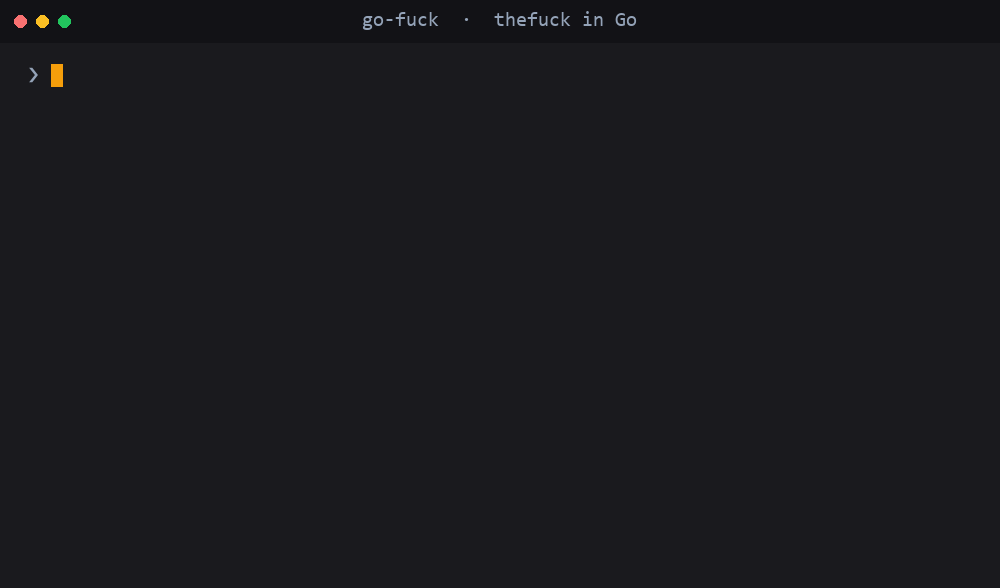
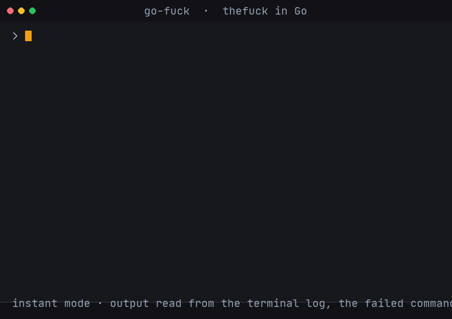

# go-fuck

[](https://github.com/leafevans/go-fuck/actions/workflows/ci.yml)
[](https://github.com/leafevans/go-fuck/actions/workflows/codeql.yml)
[](https://github.com/leafevans/go-fuck/actions/workflows/security.yml)
[](https://leafevans.github.io/go-fuck/)
[](https://pkg.go.dev/github.com/leafevans/go-fuck/v4)
[](LICENSE)

[English](README.md) | [简体中文](README.zh-CN.md)

A fast, dependency-free reimplementation of [thefuck](https://github.com/nvbn/thefuck) in Go.

**Project status:** go-fuck is stable as of **3.0.0**. The settings file and the `--json` output
are covered by compatibility guarantees (see [UPGRADING.md](UPGRADING.md)).

`go-fuck` fixes the command you just typed and got wrong. Run the `fuck` alias after a failure and
go-fuck reads the previous terminal output when capture is available, falls back to replaying the
command, matches a rule against it and executes the corrected command once you confirm the
suggestion.



```console
$ git push
fatal: The current branch main has no upstream branch.
To push the current branch and set the remote as upstream, use

    git push --set-upstream origin main

$ fuck
› git push --set-upstream origin main  [enter · ↑↓ · ctrl+c]
```

## Quick start

Choose the package manager for your platform:

| Platform             | Recommended installation                                                                                                          |
| -------------------- | --------------------------------------------------------------------------------------------------------------------------------- |
| Windows              | `scoop bucket add go-fuck https://github.com/leafevans/go-fuck`, then `scoop install go-fuck`                                     |
| macOS / Linux        | `brew tap leafevans/go-fuck https://github.com/leafevans/go-fuck`, then `brew trust leafevans/go-fuck` and `brew install go-fuck` |
| Arch Linux           | `yay -S go-fuck` or `paru -S go-fuck`                                                                                             |
| Any platform with Go | `go install github.com/leafevans/go-fuck/v4/cmd/go-fuck@latest`                                                                   |

Then configure the shell alias and follow the reload command printed by setup:

```console
$ go-fuck --setup
```

After the alias is loaded, run a command that fails and type `fuck` to correct it. See
[Installation](#installation) for prebuilt archives, checksum verification and other options.

## Contents

1. [Quick start](#quick-start)
2. [Why Go](#why-go)
3. [Features](#features)
4. [Requirements](#requirements)
5. [Installation](#installation)
6. [Shell setup](#shell-setup)
7. [First steps](#first-steps)
8. [How it works](#how-it-works)
9. [Terminal capture and instant mode](#terminal-capture-and-instant-mode)
10. [Preview and machine readable output](#preview-and-machine-readable-output)
11. [Settings](#settings)
12. [Confirmation keys](#confirmation-keys)
13. [Rules](#rules)
14. [Creating custom rules](#creating-custom-rules)
15. [Differences from thefuck](#differences-from-thefuck)
16. [Documentation](#documentation)
17. [Contributing](#contributing)
18. [License](#license)
19. [Acknowledgements](#acknowledgements)

## Why Go

- **One static binary.** A single `go-fuck` executable (or `go-fuck.exe` on Windows) contains
  everything. No interpreter, no packages and no runtime dependencies.
- **Fast startup.** A native Go binary starts in milliseconds, without importing an interpreter and
  its modules.
- **Cross-platform by default.** The same source builds for Linux, macOS and Windows on amd64 and
  arm64, and CI builds and tests all three systems.
- **Small, dependency-free codebase.** Standard library only, formatted with `gofmt` and organized
  so a new rule is one file plus one test file.

### Benchmarks

The correction hot path and the shell history parser have Go benchmarks
(`task bench`); they do not depend on the installed tools. Measured on an AMD Ryzen 7 7730U (16 logical CPUs) with Go 1.27:

| Benchmark                                                          | Result              |
| ------------------------------------------------------------------ | ------------------- |
| Full correction path (select rules, match them, order suggestions) | ~0.2 ms/op          |
| Matching every rule against a captured output                      | ~0.18 ms/op         |
| Matching rules when the command output could not be captured       | ~1.4 µs/op          |
| Parsing a 20,000 line shell history file                           | ~0.7 ms/op (1.5 MB) |
| Restoring a multi-line command from the bash alias history         | ~0.65 µs/op         |
| Restoring a command from the zsh history array                     | ~42 ns/op           |

The rule engine adds roughly 0.2 ms. With terminal capture active, wall-clock time is dominated by
the native process startup and reading the terminal log; `capture_mode: "rerun"` keeps the older
behavior of executing the failed command again.
CI compares the allocated bytes and objects per operation of every benchmark with
`benchmarks/baseline.txt` (`task bench-guard`); timing is not compared because it
depends on the runner. To record an intentional allocation change, regenerate the
baseline with `go run ./tools/benchguard -bench benchmark.txt -baseline benchmarks/baseline.txt -update`.

## Features

- Shell integration for **bash**, **zsh**, **fish**, **tcsh** and **PowerShell**.
- Machine readable JSON output for editor plugins, scripts and AI agents with `--json`.
- Interactive confirmation prompt with keyboard navigation, or skip it with `-y`/`--yes`.
- Zero-rerun terminal capture by default for Bash, Zsh and PowerShell, with explicit `auto`,
  `instant` and `rerun` policies.
- `--explain` reports capture provenance, matching rules, explanations, side effects and execution
  order without executing anything.
- Re-runs go-fuck when the corrected command fails with `-r`/`--repeat`; `--force-command` fixes an
  arbitrary command instead of the previous one.
- A single ember theme for the version banner, confirmation prompt, help text, setup messages and
  diagnostics: shared `›`/`×`/`·` symbols, an fzf prompt in the same palette, 24 bit, 256 color and
  16 color fallbacks, and `NO_COLOR` support.
- A JSON settings file with defaults for every option, environment variable overrides using the
  `GOFUCK_*` prefix and the legacy `THEFUCK_*` prefix, rule priorities, disabled rules and
  per-rule settings.
- Custom rules as compiled Go rules or declarative JSON files in the configuration directory.

## Requirements

- **Go 1.27 or newer** to build from source. The JSON documents (settings, custom rules,
  `--json`, `--doctor --json`) are handled by `encoding/json/v2`, which was stabilized in Go 1.27.
  `GOTOOLCHAIN=auto`, the default of current toolchains, downloads Go 1.27 automatically when
  needed; prebuilt release archives and package manager installs do not need Go at all.
- **No runtime dependencies.** The compiled binary is self-contained.
- A supported shell for the alias: bash, zsh, fish, tcsh or PowerShell. On Windows, PowerShell is
  recommended; a `cmd.exe` shim is provided as well.

## Installation

### With Homebrew (macOS and Linux)

The repository doubles as a Homebrew tap:

```bash
brew tap leafevans/go-fuck https://github.com/leafevans/go-fuck
brew trust leafevans/go-fuck
brew install go-fuck
```

The formula installs the prebuilt binary for your platform, so no Go toolchain is
needed. Upgrade with `brew upgrade go-fuck`.

### With Scoop (Windows)

```powershell
scoop bucket add go-fuck https://github.com/leafevans/go-fuck
scoop install go-fuck
```

Upgrade with `scoop update go-fuck`.

### With the AUR (Arch Linux)

The package is in the [Arch User Repository](https://aur.archlinux.org/packages/go-fuck) and builds
from source:

```bash
yay -S go-fuck        # or: paru -S go-fuck
```

Or install it manually with `makepkg`:

```bash
git clone https://aur.archlinux.org/go-fuck.git
cd go-fuck
makepkg -si
```

Upgrade it with your AUR helper (`yay -Syu` or `paru -Syu`). The AUR package
targets x86_64; on other architectures use `go install` or the prebuilt binaries.

### With `go install`

```bash
go install github.com/leafevans/go-fuck/v4/cmd/go-fuck@latest
```

The module path ends in `/v3` because the major version is part of the Go module path; use the
command above, the module without the suffix only carries the old 1.x releases. The binary is
installed into `$(go env GOPATH)/bin` (`%USERPROFILE%\go\bin` on Windows). Make sure that
directory is on your `PATH`.

### Prebuilt binaries

Download the archive for your operating system and architecture from the
[releases page](https://github.com/leafevans/go-fuck/releases), unpack it and place the `go-fuck`
binary somewhere on your `PATH`. Linux and macOS archives contain the raw binary, Windows archives
contain `go-fuck.exe`. Every release ships a `checksums.txt` file that you can use to verify the
download.

From a source checkout, the update scripts install prebuilt binaries into
`~/.local/bin` by default:

```sh
sh scripts/update-go-fuck.sh                  # Linux or macOS
sh scripts/update-go-fuck.sh v3.0.1 /path/to/bin
```

```powershell
./scripts/update-go-fuck.ps1                  # Windows and the default WSL distro
./scripts/update-go-fuck.ps1 -SkipWsl         # Windows only
./scripts/update-go-fuck.ps1 -WslDistro Ubuntu
```

Both scripts verify SHA256 checksums before installation, limit request times,
and retry failed requests up to three attempts. A failed download, verification
or replacement preserves the installed binary. Windows supports AMD64 and ARM64;
Linux and macOS support amd64 and arm64. Pass a version with or without `v` to
install a specific release.

The PowerShell updater runs the WSL installer through `sh` explicitly, so Fish
users do not need to change their login shell. If GitHub is unreachable from the
WSL network, it downloads the Linux archive through Windows, verifies the
checksum on both sides and then performs an atomic WSL install.

### From source

```bash
git clone https://github.com/leafevans/go-fuck.git
cd go-fuck
task build          # or: go build -o go-fuck ./cmd/go-fuck
```

`task install` runs `go install ./cmd/go-fuck` instead. On Windows the build produces
`go-fuck.exe`.

## Shell setup

go-fuck is a normal executable; the alias function connects it to the previous command and evaluates
the corrected command that go-fuck prints. `go-fuck --alias` generates the function for the detected
shell, so the setup is the same everywhere and always matches the installed binary.

### Automatic setup

`go-fuck --setup` writes the alias line to the detected shell's configuration file and prints the
command that reloads it to stdout. Warnings and failures are written to stderr. Running it again is
safe: when the line is already present go-fuck reports that the shell is already configured and
leaves the file untouched.

By default setup selects `capture_mode: auto` and configures
[terminal capture](#terminal-capture-and-instant-mode) on supported shells. Use
`--capture-mode=rerun` to keep the regular alias, or `--capture-mode=instant` to require terminal
capture. The legacy `--enable-experimental-instant-mode` flag remains as a compatibility alias.

bash, zsh, fish and tcsh are configured when their configuration file already exists. PowerShell is
configured for every installed flavor: go-fuck asks `powershell.exe` and `pwsh` for their
`$PROFILE` (the Documents folder can be redirected, for example to OneDrive) and creates the profile
file when it is missing.

For PowerShell, setup checks both the current-host `$PROFILE` and its all-hosts `profile.ps1`
sibling before writing anything. If more than one initialization is active, or a profile generates
the alias through a custom cache, setup reports the conflicting files, makes no changes and exits
with status 1. Keep one direct initialization and run setup again.

Commented initialization lines do not count as an active setup. Running setup on an existing
initialization line migrates it in place while preserving comments and indentation. Upgrading an
old instant-mode initialization preserves unrelated commands, comments, indentation and line
endings.

### Manual setup

Add the line for your shell to its configuration file, then start a new shell or reload the file:

```console
# bash: ~/.bashrc (or ~/.bash_profile on macOS)
# zsh:  ~/.zshrc
eval "$(go-fuck --alias --capture-mode=auto)"

# fish: ~/.config/fish/config.fish
go-fuck --alias --capture-mode=auto | source

# tcsh: ~/.tcshrc
eval `go-fuck --alias --capture-mode=auto`

# PowerShell: $PROFILE
iex "$(go-fuck --alias --capture-mode=auto)"
```

go-fuck detects the shell from `TF_SHELL` and otherwise from the process tree. If detection is
unreliable, for example when generating the alias from a setup script, set it explicitly:
`TF_SHELL=fish go-fuck --alias`.

### Custom alias name

Pass the name after `--alias`:

```bash
eval "$(go-fuck --alias FUCK --capture-mode=auto)"
```

The name has to be a valid shell function name. Without an argument, the alias is named after the
`TF_ALIAS` environment variable when it is set, and `fuck` otherwise.

### How the alias works

The Fish and PowerShell aliases preserve multi-line corrections and only evaluate a correction
when go-fuck exits successfully. Information options such as `--json` are printed directly.

The generated function exports a few variables, calls go-fuck and evaluates the corrected command that
go-fuck prints on standard output:

| Variable                      | Set by                 | Purpose                                                                                                                                  |
| ----------------------------- | ---------------------- | ---------------------------------------------------------------------------------------------------------------------------------------- |
| `TF_SHELL`                    | the alias              | shell name (`bash`, `zsh`, `fish`, `tcsh`, `powershell`); go-fuck uses it instead of guessing from the process tree                      |
| `TF_ALIAS`                    | the alias              | name of the alias function; used in messages and by the repeat mechanism                                                                 |
| `TF_ALIAS_VERSION`            | the shell alias        | alias format version (currently 4); go-fuck warns when an older alias is used                                                            |
| `TF_HISTORY`                  | the bash and zsh alias | the previous history entry, marked so a command typed over several lines stays one value                                                 |
| `TF_SHELL_ALIASES`            | the bash and zsh alias | the shell aliases, expanded before the command is matched                                                                                |
| `GOFUCK_ARGUMENT_PLACEHOLDER` | the alias              | separates go-fuck's own arguments from the arguments of the corrected command; the legacy `THEFUCK_ARGUMENT_PLACEHOLDER` is accepted too |

The bash alias reads the previous entry with `fc` and the zsh alias reads it from the zsh
history array; both prefix the value with an internal marker so a command typed over several lines is
restored as one command. Older aliases that export a window of history lines are still supported. The
fish alias passes the previous command explicitly via its `$history[1]` variable. Because
`TF_SHELL` is always set by the alias, go-fuck uses the right shell-specific behavior even when the
process tree is unreliable (containers, `sudo`, wrappers).

### Windows: cmd.exe and PowerShell shims

The `scripts/` directory contains two small Windows shims that mirror the scripts shipped with
thefuck:

- `scripts/fuck.bat` — for `cmd.exe`. It passes the previous command from the doskey history to
  go-fuck and runs the corrected command in the current console.
- `scripts/fuck.ps1` — for PowerShell. The first call writes the go-fuck initialization to your
  profile and defines `fuck()` for the current session; later calls delegate to the function.

Put the script somewhere on your `PATH` and call `fuck`. The release archives of every platform
ship both shims in their `scripts/` directory.

## First steps

The introduction shows a git correction. Two more examples:

```console
$ cd project/src
cd: no such file or directory: project/src

$ fuck
› mkdir -p project/src && cd project/src  [enter · ↑↓ · ctrl+c]
```

```console
$ echo "hello'
zsh: unmatched "

$ fuck
› echo "hello"  [enter · ↑↓ · ctrl+c]
```

Common options:

| Option                               | Meaning                                                                                                                                                                                                   |
| ------------------------------------ | --------------------------------------------------------------------------------------------------------------------------------------------------------------------------------------------------------- |
| `-y`, `--yes`, `--yeah`, `--hard`    | execute the first suggestion without asking                                                                                                                                                               |
| `-r`, `--repeat`                     | re-run go-fuck if the corrected command fails                                                                                                                                                             |
| `--force-command CMD`                | fix `CMD` instead of the previous command                                                                                                                                                                 |
| `--output-from FILE`                 | read the output of `--force-command` from `FILE` (or standard input with `-`) instead of re-running it                                                                                                    |
| `--doctor`                           | print a diagnostic report: detected shell, alias, settings file, history and optional integrations; `--doctor --json` prints it as JSON                                                                   |
| `--list-rules`                       | print the names of the built-in rules and exit (useful for the `rules`, `exclude_rules` and `priority` settings); with `--json` one object per rule with its priority and flags                           |
| `--no-rerun`                         | never re-run the original command to collect output; use supplied output or the instant log when available                                                                                                |
| `--capture-mode MODE`                | choose `auto`, `instant` or `rerun` capture policy                                                                                                                                                        |
| `--preview`                          | show suggestions without re-running the original command, prompting, or applying a fix; combine with `--json` for structured output                                                                       |
| `--explain`                          | show capture provenance, rules, side effects and execution order without executing the suggestion                                                                                                         |
| `--json`                             | print suggestions as JSON without executing them; add `--no-rerun` to prevent re-running the original command                                                                                             |
| `-d`, `--debug`                      | print debug information to stderr                                                                                                                                                                         |
| `-v`, `--version`                    | print version/build information to stdout: a themed banner in a terminal, one line when piped; `--debug --version` adds the config path, executable path, build module, instant mode, fzf and alias state |
| `-h`, `--help`                       | print the full option list to stdout                                                                                                                                                                      |
| `-a`, `--alias[=ALIAS]`              | print the evaluable shell alias to stdout; optional `ALIAS` overrides `TF_ALIAS`                                                                                                                          |
| `--setup`                            | write the alias to the detected shell's configuration file (bash, zsh, fish, tcsh, PowerShell)                                                                                                            |
| `--enable-experimental-instant-mode` | deprecated alias for `--capture-mode=instant` when generating an alias or setup line                                                                                                                      |

Normal information from the information commands is written to stdout. Warnings, errors, debug
messages and correction-flow diagnostics are written to stderr. Human-readable output uses the same
`go-fuck <command>` heading, Ember colors, aligned fields and `OK`/`INFO`/`WARN`/`FAIL` statuses only
when the destination is a terminal. Pipes, `NO_COLOR` and `no_colors` receive plain text.

`-a` is deliberately unstyled: its stdout is passed directly to `eval`, `source` or `iex`.
`--json`, `--doctor --json` and `--list-rules --json` are also machine-readable output and are never
decorated.

### Troubleshooting

If `fuck` does nothing, or go-fuck cannot find the command that failed, run the diagnostic report:

```console
$ go-fuck --doctor
```

It checks the detected shell, the alias in the shell configuration file (for PowerShell every
installed flavor's profile), the settings file (including ignored unknown keys), the command history
and the optional integrations (fzf and instant mode). It also resolves the executable in `PATH`: when
an older or differently installed copy comes first, `--doctor` warns that the shell alias starts that
copy instead of the running build. On Windows it additionally warns when the Windows build was
started from inside WSL, where the shell detection sees the Windows host instead of the Linux shell.
For instant mode it validates the logged shell's terminal log and warns when the instant mode line is
no longer the last prompt definition in the PowerShell profile. Warnings include the command that
fixes them, and `--doctor --json` prints the same report as JSON.

`setup` and `doctor` are options, not corrections: `go-fuck --setup` configures the alias and
`go-fuck --doctor` prints the report. Typing `go-fuck setup` or `go-fuck doctor` runs go-fuck
outside the alias, where these two words are rejected with the matching flag instead of being
executed as a shell command and failing without an explanation.

To list the rule names accepted by the `rules`, `exclude_rules` and `priority` settings, run:

```console
$ go-fuck --list-rules
```

In a terminal the list has a short heading and the rule count. When stdout is piped or redirected,
the output remains exactly one rule name per line.

`go-fuck --list-rules --json` prints one JSON object per rule with its `name`, `priority`,
`enabled_by_default`, `requires_output` and `side_effect` fields, which is convenient for
editor plugins and scripts that generate settings files.

The `fuck` shell function passes the information commands (`--list-rules`, `--doctor`,
`--json`, `--explain`, `--alias`, `--help`, `--version`) through to go-fuck unchanged, so
`fuck --list-rules` prints the rule list just like `go-fuck --list-rules`. Shell aliases generated by
older releases evaluate go-fuck's standard output as the corrected command instead, which is why
`fuck --list-rules` used to report that `adb_unknown_command` is not a command: the rule list was
executed line by line. After upgrading, the alias is refreshed by the next shell start when the
configuration file evaluates `go-fuck --alias`; to refresh it in a running shell run `go-fuck --setup` or
evaluate the alias again (go-fuck warns when it detects an outdated alias).

If go-fuck prints `Your shell alias is outdated`, the installed binary is newer than the function
loaded by the current shell. Corrections can still work, but the old function may not preserve
multi-line commands or pass information commands through. Reload it without waiting for a restart:

```bash
# bash or zsh
eval "$(go-fuck --alias)"

# fish
go-fuck --alias | source

# tcsh
eval `go-fuck --alias`
```

```powershell
# PowerShell
iex "$(go-fuck --alias)"
```

The bare `--alias` follows the configured `capture_mode`; add `--capture-mode=rerun` if you want the
reloaded function to skip terminal capture.

Do not cache the output of `go-fuck --alias`. It depends on the current shell state and capture
mode, so a cache keyed only by the executable timestamp can restore initialization generated for a
different context. Evaluate the command directly in the profile instead.

If `fuck -v` reports an unexpected version, or reports PowerShell inside WSL, another `go-fuck` binary is
probably earlier in `PATH`. The pre-v2 module — `go install github.com/leafevans/go-fuck/cmd/go-fuck@latest`
without the `/v2` suffix — installs the old 0.x/1.x series into `$GOPATH/bin`, and that binary can shadow the
release one. `go-fuck --debug --version` prints the executable path (`Exe`) and the module that built the
binary (`Module`); the v4 builds report `github.com/leafevans/go-fuck/v4`. Remove or rename the old
binary, or put the v3 installation earlier in `PATH`. Inside WSL use the Linux binary
(`~/.local/bin/go-fuck`) instead of a Windows executable picked up from the interop `PATH`, and run
`hash -r` (bash) or `rehash` (zsh) in a shell that was already open before the change.

## How it works

1. You run a command and it fails. You type `fuck`.
2. The shell function exports the shell name and history and calls `go-fuck`.
3. go-fuck determines the command that failed and expands shell aliases. With `capture_mode: auto`,
   it first reads the matching output from the terminal log. If capture is unavailable, it re-runs
   the command with the `wait_command` timeout.
4. Every enabled rule is tried in priority order. A matching rule returns one or more corrected
   commands, which are sorted by priority and offered in the confirmation prompt.
5. When you accept a suggestion, go-fuck applies the rule's side effect (if any), optionally writes
   the corrected command to the shell history and prints it on standard output.
6. The shell function evaluates that output, so the corrected command runs in your shell exactly as
   if you had typed it.

`instant` never re-runs the command when capture is unavailable. `rerun` preserves the older
behavior for shells or commands where terminal capture is undesirable.

On Windows the command is re-run with the PowerShell flavor that started go-fuck, so PowerShell
native commands and syntax produce their real error messages instead of an unrelated cmd.exe
"not recognized" error. Processes that were not started from PowerShell, and processes whose alias
does not report the shell through `GOFUCK_SHELL`, keep the cmd.exe behavior.
The capture subprocess uses English PowerShell diagnostics so matching also works on localized
Windows installations. This does not change the language of your interactive PowerShell session.

## Terminal capture and instant mode

Terminal capture reads the output of the previous command from a terminal log instead of re-running
it. It is implemented for **bash and zsh on Linux and macOS** and for **PowerShell on Windows**;
other shells fall back to `rerun`.



`go-fuck --setup` enables `capture_mode: auto` for supported shells. The generated line records the
selected mode explicitly:

Linux and macOS:

```bash
# ~/.bashrc (or ~/.zshrc for zsh)
eval "$(go-fuck --alias --capture-mode=auto --enable-experimental-instant-mode)"
```

Windows (Windows PowerShell 5.1 and PowerShell 7):

```powershell
# $PROFILE
iex "$(go-fuck --alias --capture-mode=auto --enable-experimental-instant-mode)"
```

The `--enable-experimental-instant-mode` spelling remains for compatibility. Use
`--capture-mode=rerun` to opt out of terminal capture while regenerating the alias.

Restart the shell. The initialization replaces the terminal shell with a logged subshell: commands
keep working as usual, but go-fuck reads their output from the terminal log, so `fuck` does not
execute the failed command a second time. The log is a temporary file that is removed when the
logged shell exits.

On Windows the logged shell runs on a pseudo console (ConPTY), which requires Windows 10 version
1809 or newer. When ConPTY is not available, the regular alias is installed instead of closing the
terminal.

The mode is covered by end-to-end tests: an interactive bash runs on a pseudo terminal on Linux and
macOS, and Windows PowerShell runs on a pseudo console on Windows; the tests feed a command, check
the terminal log and read the output back. Commands typed over several lines (a PowerShell block or
backtick continuation, PSReadLine's Shift+Enter input or a pasted command) are treated as one history
entry, and output rows that the terminal wrapped are joined again before the rules see them. When
instant mode is enabled, `go-fuck --doctor` also validates the active terminal log (readable, not
empty, prompt marker present).

Limitations:

- The shell profile runs twice per terminal start: once in the terminal shell and once in the
  logged subshell. Slow profiles delay the first prompt twice.
- Prompt frameworks that rebuild `PS1` before every prompt (starship, powerlevel10k, ...) keep
  working, because the marker is re-added after the prompt functions run. A prompt definition added
  after the instant mode line can still hide the marker; on Windows the instant mode line has to be
  the last prompt definition in the profile.
- Full screen programs such as `vim` or `tmux` use the alternate screen, whose content is not
  part of the log; the previous screen is restored when they exit. If the terminal is closed while
  such a program is still running, the end of the log may be missing.
- On Windows the terminal size is polled, so a resized window reaches the logged shell with a short
  delay.
- The log keeps the newest 1 MiB of terminal output, including when a single write exceeds that
  limit. ANSI colors, window titles and hyperlinks are removed while keeping their visible text.
  Command lookup preserves argument order and checks word boundaries to avoid reusing output from a
  different invocation. The renderer is simpler than the reference
  implementation's pyte emulation: ANSI stripping and carriage return overwrites on Linux and macOS,
  a small screen model for the ConPTY stream on Windows, so full screen programs can still differ.
- Long output rows are joined again because the console wrapped them. On Windows a row that is one
  column short of the terminal width is treated as wrapped, so a line that happens to be exactly that
  wide and is followed by a newline can be merged with the next line.

The logged shell exports `GOFUCK_INSTANT_MODE=true` to indicate that terminal capture is active.
The choice between automatic, instant-only and rerun-only behavior comes from `capture_mode`.

## Preview and machine readable output

Use `--explain` to inspect the full non-executing plan:

```console
$ go-fuck --explain --capture-mode instant --force-command "git brnch"
```

It reports how the output was captured and lists every suggestion with its rule, explanation,
optional side effect and final execution command. `--explain` does not re-run the failed command,
perform side effects, update history or execute the correction. Combine it with `--json` for
machine-readable capture provenance.

Use `--preview` to see suggestions without applying them, even with `--yes` or `--repeat`.
It does not re-run the original command or update shell history. It uses supplied output or a
matching instant log entry when available; rules can still perform lookups to build suggestions.
The human-readable preview goes to stderr so shell aliases cannot evaluate it as a correction.

```console
$ go-fuck --preview --force-command "unzip files.zip"
$ go-fuck --preview --json --force-command "git push" --output-from failed-output.log
```

`--json` prints the correction result as JSON instead of opening the interactive prompt. It is
intended for editor plugins, scripts and AI agents. Current shell aliases print the JSON without
evaluating it. By default go-fuck may still re-run the original command to collect output. Use
`go-fuck --json --no-rerun --force-command "git brnch"` to prevent that. Without supplied output
or a matching instant log entry, only rules that do not require output can match.

When the caller already captured the output of the failed command (an editor, a terminal
integration or an AI agent usually did), pass it with `--output-from FILE` instead of letting go-fuck
re-run the command. Use `-` to read the output from standard input:

```console
$ go-fuck --json --force-command "git push" --output-from failed-output.log
$ cat failed-output.log | go-fuck --json --force-command "git push" --output-from -
```

This avoids re-running a command with side effects and works when the command cannot be run again.
The output is treated exactly like captured output, so the same rules and suggestions apply.

```console
$ go-fuck --json --force-command "git brnch"
{
  "schema_version": 1,
  "command": "git brnch",
  "suggestions": [
    {
      "command": "git branch",
      "priority": 1000,
      "side_effect": false,
      "rule": "git_unknown_command",
      "reason": "Matched rule: git_unknown_command"
    },
    {
      "command": "git brnch",
      "priority": 5000,
      "side_effect": false,
      "rule": "history",
      "reason": "Suggest a similar command from shell history"
    }
  ]
}
```

The suggestions are ordered as they would be offered interactively. `priority` is the rule
priority (lower values are tried first). `rule` is the name of the rule that produced the
suggestion. `reason` explains the correction or identifies the matching rule. `side_effect`
reports whether an extra rule action would run before the corrected command, and
`side_effect_description` describes that action when present. `side_effect: false` does not
mean executing the corrected command is risk-free. The history rule can repeat
the original command as a fallback suggestion; consumers that only want real corrections can skip
suggestions equal to `command`.

`output` is the captured standard output and standard error of the failed command; it is omitted
when the output could not be captured. Output larger than 32 KiB is cut at a UTF-8 boundary and
`output_truncated` is set to `true`. The optional `capture_source` field is `provided`,
`instant_log`, `rerun` or `none`. The example above omits the `output` and capture fields for
brevity.

In JSON mode go-fuck does not execute the corrected command, does not apply side effects and does
not update the shell history; the caller decides what to do with the suggestions. The exit code is
0 once the JSON was written, even when no rule matched and `suggestions` is empty.

The JSON document is a stable machine readable contract. `schema_version` is `1` for the whole
1.x, 2.x and 3.x series; it is only incremented for a breaking layout change, while new optional fields may be
added in minor releases. Consumers must ignore unknown fields and must not rely on the key order.
The document is always written to stdout; diagnostics stay on stderr.

## Settings

To build v4 from a source checkout, run `go build ./cmd/go-fuck`. The `/v3` Go
module path continues to select the previous major series.

The legacy `git_commit_reset` and `git_commit_amend` rules are disabled by default:
no generic commit failure proves that rewriting the previous commit is the right fix.
Explicitly list either name in `rules` only if you want these history-rewriting suggestions.
Their suggestions include a warning in the reason; known hook, identity and merge failures
remain excluded even when you opt in.

`port_already_in_use` is also disabled by default. A port conflict does not imply that
its owner is safe to terminate. Explicitly enable it in `rules` only if you want
termination suggestions; it requires `lsof` and a single valid TCP listener PID.
Inspect the owner before accepting: PID lookup cannot eliminate process-exit or
PID-reuse races between displaying a suggestion and executing it.

Settings are stored in `settings.json` inside the go-fuck directory of the user configuration
directory returned by Go's `os.UserConfigDir()`:

| Operating system | Path                                                                            |
| ---------------- | ------------------------------------------------------------------------------- |
| Linux / BSD      | `~/.config/go-fuck/settings.json` (or `$XDG_CONFIG_HOME/go-fuck/settings.json`) |
| macOS            | `~/Library/Application Support/go-fuck/settings.json`                           |
| Windows          | `%AppData%\go-fuck\settings.json`                                               |

The file is created with the default settings on first use. JSON does not support comments, so the
generated file contains an explanatory `_comment` field; it is ignored when the file is loaded.

Unknown keys are ignored by default, so a settings file written by a newer go-fuck keeps working
with an older one. They are reported by `go-fuck --doctor` and by a correction run, so a typo such
as `rule` instead of `rules` does not go unnoticed. Rule names in `rules`, `exclude_rules` and
`priority` are validated the same way: an unknown name is reported with its setting, because a typo
would otherwise silently ignore the rule or its priority override. Contradictory rule settings are
reported too: a rule that appears in both `rules` and `exclude_rules`, or a `priority` override for an
excluded or disabled rule, would be silently ignored (`exclude_rules` wins). Values out of range are
reported the same way and replaced with the defaults: `wait_command` and `wait_slow_command` must be between 1 and
3600 seconds (a zero or negative value used to kill the re-run command immediately), and
`history_limit` and `num_close_matches` must not be negative. Set `strict_settings` (or
`GOFUCK_STRICT_SETTINGS=true`) to reject unknown keys instead: the file is reported as invalid and
not applied. Invalid JSON or a value of the wrong type is always reported and the file is not
applied, so go-fuck falls back to the built-in defaults instead of running with a half applied
configuration. From 1.0.0
the keys above and their meaning are frozen; new optional keys may be added in minor releases.

A minimal file that customizes a few values:

```json
{
	"rules": ["All rules enabled"],
	"exclude_rules": ["git_push"],
	"capture_mode": "auto",
	"wait_command": 10,
	"require_confirmation": true,
	"priority": {
		"cd_mkdir": 100
	},
	"settings": {}
}
```

All fields:

| Key                             | Type              | Default                                                      | Meaning                                                                                                                                                                                      |
| ------------------------------- | ----------------- | ------------------------------------------------------------ | -------------------------------------------------------------------------------------------------------------------------------------------------------------------------------------------- |
| `rules`                         | array of strings  | `["All rules enabled"]`                                      | Rules that are enabled. The sentinel value `"All rules enabled"` enables every rule that is enabled by default; list explicit rule names to enable exactly those rules.                      |
| `exclude_rules`                 | array of strings  | `[]`                                                         | Rules that are never loaded, even when enabled.                                                                                                                                              |
| `wait_command`                  | integer           | `3`                                                          | Seconds to wait for the output of the re-run command.                                                                                                                                        |
| `require_confirmation`          | boolean           | `true`                                                       | Ask before executing a corrected command.                                                                                                                                                    |
| `fzf`                           | boolean           | `false`                                                      | Use [fzf](https://github.com/junegunn/fzf) as the selection prompt when it is installed. Falls back to the built-in prompt automatically.                                                    |
| `strict_settings`               | boolean           | `false`                                                      | Reject unknown top-level keys as an error instead of ignoring and warning about them.                                                                                                        |
| `no_colors`                     | boolean           | `false`                                                      | Disable colored output.                                                                                                                                                                      |
| `debug`                         | boolean           | `false`                                                      | Print debug information to stderr.                                                                                                                                                           |
| `priority`                      | object of integer | `{}`                                                         | Per-rule priority overrides. Lower values are tried first; the built-in default is `1000`.                                                                                                   |
| `history_limit`                 | integer           | `0`                                                          | Maximum number of shell history lines that are read. `0` means no limit.                                                                                                                     |
| `alter_history`                 | boolean           | `true`                                                       | Write the corrected command back to the shell history.                                                                                                                                       |
| `wait_slow_command`             | integer           | `15`                                                         | Seconds to wait for the output of commands listed in `slow_commands`.                                                                                                                        |
| `slow_commands`                 | array of strings  | `["lein", "react-native", "gradle", "./gradlew", "vagrant"]` | Commands that are expected to be slow to re-run.                                                                                                                                             |
| `repeat`                        | boolean           | `false`                                                      | If the corrected command fails, run go-fuck again.                                                                                                                                           |
| `capture_mode`                  | string            | `"auto"`                                                     | Capture policy: `auto` prefers the terminal log and falls back to rerun, `instant` never reruns, `rerun` skips terminal capture. See [Terminal capture](#terminal-capture-and-instant-mode). |
| `instant_mode`                  | boolean           | deprecated                                                   | Legacy compatibility key. Without `capture_mode`, `true` maps to `auto` and `false` maps to `rerun`.                                                                                         |
| `num_close_matches`             | integer           | `3`                                                          | Maximum number of close matches suggested for misspelled commands.                                                                                                                           |
| `env`                           | object of string  | `{"LC_ALL": "C", "LANG": "C", "GIT_TRACE": "1"}`             | Environment variables added when the failed command is re-run.                                                                                                                               |
| `excluded_search_path_prefixes` | array of strings  | `[]`                                                         | `PATH` prefixes that are skipped when searching for executables.                                                                                                                             |
| `settings`                      | object            | `{} in the default file`                                     | Rule-specific string settings, read by rules with `conf.Current().String(key, default)`.                                                                                                     |

### Environment variables

Every setting can be set with an environment variable. The modern prefix is `GOFUCK_`; the legacy
`THEFUCK_` prefix from the original implementation is still recognized, so an existing thefuck
configuration keeps working. For example, `GOFUCK_WAIT_COMMAND=10` and
`THEFUCK_WAIT_COMMAND=10` do the same thing. If both prefixes are set for the same legacy setting,
the `THEFUCK_*` variable is applied last and wins. `GOFUCK_CAPTURE_MODE` takes precedence over the
deprecated instant-mode variables.

| Suffix                          | Type                                                                              | Example                                                                                              | Corresponding setting                                               |
| ------------------------------- | --------------------------------------------------------------------------------- | ---------------------------------------------------------------------------------------------------- | ------------------------------------------------------------------- |
| `RULES`                         | colon separated list                                                              | `GOFUCK_RULES='sudo:no_command'`                                                                     | `rules`; the token `DEFAULT_RULES` stands for `"All rules enabled"` |
| `EXCLUDE_RULES`                 | colon separated list                                                              | `GOFUCK_EXCLUDE_RULES='git_push'`                                                                    | `exclude_rules`                                                     |
| `WAIT_COMMAND`                  | integer seconds                                                                   | `GOFUCK_WAIT_COMMAND=10`                                                                             | `wait_command`                                                      |
| `REQUIRE_CONFIRMATION`          | boolean                                                                           | `GOFUCK_REQUIRE_CONFIRMATION=false`                                                                  | `require_confirmation`                                              |
| `FZF`                           | boolean                                                                           | `GOFUCK_FZF=true`                                                                                    | `fzf`                                                               |
| `STRICT_SETTINGS`               | boolean                                                                           | `GOFUCK_STRICT_SETTINGS=true`                                                                        | `strict_settings`                                                   |
| `NO_COLORS`                     | boolean                                                                           | `GOFUCK_NO_COLORS=true`                                                                              | `no_colors`                                                         |
| `DEBUG`                         | boolean                                                                           | `GOFUCK_DEBUG=true`                                                                                  | `debug`                                                             |
| `PRIORITY`                      | `rule=priority` list separated by colons                                          | `GOFUCK_PRIORITY='cd_mkdir=100:git_push=900'`                                                        | `priority`                                                          |
| `HISTORY_LIMIT`                 | integer                                                                           | `GOFUCK_HISTORY_LIMIT=2000`                                                                          | `history_limit`                                                     |
| `ALTER_HISTORY`                 | boolean                                                                           | `GOFUCK_ALTER_HISTORY=false`                                                                         | `alter_history`                                                     |
| `WAIT_SLOW_COMMAND`             | integer seconds                                                                   | `GOFUCK_WAIT_SLOW_COMMAND=30`                                                                        | `wait_slow_command`                                                 |
| `SLOW_COMMANDS`                 | colon separated list                                                              | `GOFUCK_SLOW_COMMANDS='lein:gradle'`                                                                 | `slow_commands`                                                     |
| `REPEAT`                        | boolean                                                                           | `GOFUCK_REPEAT=true`                                                                                 | `repeat`                                                            |
| `CAPTURE_MODE`                  | `auto`, `instant` or `rerun`                                                      | `GOFUCK_CAPTURE_MODE=auto`                                                                           | `capture_mode`                                                      |
| `INSTANT_MODE`                  | boolean, deprecated                                                               | `GOFUCK_INSTANT_MODE=true`                                                                           | maps to `capture_mode` when no explicit mode is set                 |
| `NUM_CLOSE_MATCHES`             | integer                                                                           | `GOFUCK_NUM_CLOSE_MATCHES=5`                                                                         | `num_close_matches`                                                 |
| `EXCLUDED_SEARCH_PATH_PREFIXES` | list separated by the OS path list separator (`:` on Linux/macOS, `;` on Windows) | `GOFUCK_EXCLUDED_SEARCH_PATH_PREFIXES='/snap:/mnt'` (Linux/macOS), `'C:\\Tools;C:\\Other'` (Windows) | `excluded_search_path_prefixes`                                     |

The `env` map can only be set in `settings.json`. Booleans accept `true` and `false`
(case-insensitive).

Settings are applied in increasing order of precedence:

1. built-in defaults,
2. `settings.json`,
3. environment variables,
4. command line options such as `-y`, `-d` and `-r`.

## Confirmation keys

By default go-fuck asks before running the corrected command. The prompt shows the suggestion and the
available actions:

| Key                     | Action                         |
| ----------------------- | ------------------------------ |
| `Enter`                 | execute the selected command   |
| `↑`, `Ctrl+N`, `k`, `e` | select the previous suggestion |
| `↓`, `Ctrl+P`, `j`, `n` | select the next suggestion     |
| `Ctrl+C`, `q`           | abort without running anything |

Disable the prompt with `require_confirmation: false` in `settings.json` or by passing `-y`.

### fzf integration

If [fzf](https://github.com/junegunn/fzf) is installed, go-fuck can use it as the selection prompt.
Enable it once in `settings.json`:

```json
{
	"fzf": true
}
```

or per shell with `export GOFUCK_FZF=true`. When fzf runs, the suggestions are listed with a
`›` prompt (`Enter` selects, `Esc` aborts); go-fuck falls back to its built-in prompt
automatically when fzf is not installed or fails. `-y`/`require_confirmation: false` still skips
the selection entirely.

Both selectors display multi-line commands and control characters as visible escapes
on one line, while preserving the original command for execution. Suggestions with
side effects show `(+side effect)`; commands with different side effects remain
separate choices. The fzf prompt also respects `no_colors` and `NO_COLOR`.

## Rules

The built-in rules are compiled into the binary, and declarative JSON rules can be loaded from the
configuration directory (see [Creating custom rules](#creating-custom-rules)). Each rule decides
whether it applies to a failed command and returns one or more corrected commands. There are 255
built-in rules: 169 ported from the reference implementation plus 86 go-fuck specific rules for
failures that thefuck does not handle, including the GitHub and GitLab CLIs, kubectl/kind/kustomize,
uv, cargo, Helm, pnpm, the npm, pnpm, yarn and uv lock file checks, the Go toolchain and go.sum,
Node.js, bun, Deno, Docker Compose, just, Poetry, make, the go-task runner, minikube, Bundler,
Chocolatey, the .NET CLI, rustup toolchains, the Dart and Flutter command-line tools, the uv and Cargo
project setup corrections, the PowerShell file operation and cmd.exe corrections, git switch and safe.directory corrections and divergent, clobbered or blocked
git operations. For example, `git_branch_create_flag` switches between `git switch -c` and
`git checkout -b` when Git rejects the other command's branch-creation flag.

`gcloud_cli` and `bazel_missing_target` use explicit suggestions from the tools’ diagnostics.
`mise_missing_version` is opt-in: it suggests installing only the exact tool versions named
in the shim error, without changing project configuration or trust settings.

The list below is generated from the compiled rules:

<!-- RULES_LIST_START -->
- `adb_unknown_command`
- `ag_literal`
- `apt_get`
- `apt_get_search`
- `apt_invalid_operation`
- `apt_list_upgradable`
- `apt_upgrade`
- `aws_cli`
- `az_cli`
- `bazel_missing_target`
- `brew_cask_dependency`
- `brew_install`
- `brew_link`
- `brew_reinstall`
- `brew_uninstall`
- `brew_unknown_command`
- `brew_update_formula`
- `bun_script_not_found`
- `bundle_unknown_command`
- `cargo`
- `cargo_missing_bench_target`
- `cargo_missing_bin`
- `cargo_missing_example_target`
- `cargo_missing_manifest`
- `cargo_missing_test_target`
- `cargo_no_command`
- `cargo_unknown_argument`
- `cargo_unknown_command`
- `cat_dir`
- `cd_correction`
- `cd_cs`
- `cd_mkdir`
- `cd_parent`
- `chmod_x`
- `choco_install`
- `choco_unknown_command`
- `cmd_cd_mkdir`
- `cmd_missing_directory`
- `cmd_missing_file`
- `cmd_mkdir_existing`
- `cmd_pushd_mkdir`
- `cmd_rmdir_nonempty`
- `composer_not_command`
- `conda_mistype`
- `cp_create_destination`
- `cp_omitting_directory`
- `cpp11`
- `dart_unknown_command`
- `deno_task_not_found`
- `dirty_untar`
- `dirty_unzip`
- `django_south_ghost`
- `django_south_merge`
- `dnf_no_such_command`
- `docker_compose_unknown_service`
- `docker_image_being_used_by_container`
- `docker_login`
- `docker_not_command`
- `dotnet_unknown_argument`
- `dotnet_unknown_command`
- `dry`
- `fab_command_not_found`
- `fix_alt_space`
- `fix_file`
- `flutter_unknown_command`
- `gcloud_cli`
- `gem_unknown_command`
- `gh_unknown_command`
- `gh_unknown_flag`
- `git_add`
- `git_add_force`
- `git_amend_initial_commit`
- `git_bisect_usage`
- `git_branch_0flag`
- `git_branch_create_flag`
- `git_branch_delete`
- `git_branch_delete_checked_out`
- `git_branch_exists`
- `git_branch_list`
- `git_branch_missing`
- `git_checkout`
- `git_checkout_unstaged`
- `git_clone_git_clone`
- `git_clone_missing`
- `git_commit_add`
- `git_commit_amend`
- `git_commit_reset`
- `git_diff_no_index`
- `git_diff_staged`
- `git_dubious_ownership`
- `git_fetch_clobber_tag`
- `git_fix_stash`
- `git_flag_after_filename`
- `git_help_aliased`
- `git_hook_bypass`
- `git_lfs_mistype`
- `git_main_master`
- `git_merge`
- `git_merge_unrelated`
- `git_merge_unstaged`
- `git_not_command`
- `git_pull`
- `git_pull_clone`
- `git_pull_divergent`
- `git_pull_uncommitted_changes`
- `git_push`
- `git_push_different_branch_names`
- `git_push_force`
- `git_push_pull`
- `git_push_without_commits`
- `git_rebase_merge_dir`
- `git_rebase_no_changes`
- `git_rebase_unstaged`
- `git_remote_already_exists`
- `git_remote_delete`
- `git_remote_seturl_add`
- `git_rm_local_modifications`
- `git_rm_recursive`
- `git_rm_staged`
- `git_stash`
- `git_stash_pop`
- `git_submodule_missing`
- `git_switch_existing_branch`
- `git_switch_unknown_branch`
- `git_tag_force`
- `git_tag_missing`
- `git_two_dashes`
- `git_unknown_option`
- `git_unknown_remote`
- `git_worktree_branch_used`
- `git_worktree_remove_missing`
- `glab_unknown_command`
- `go_install_version`
- `go_missing_file`
- `go_missing_module`
- `go_missing_package`
- `go_missing_sum`
- `go_mod_init`
- `go_run`
- `go_unknown_command`
- `go_unknown_flag`
- `gradle_no_task`
- `gradle_wrapper`
- `grep_arguments_order`
- `grep_recursive`
- `grunt_task_not_found`
- `gulp_not_task`
- `has_exists_script`
- `helm_unknown_command`
- `heroku_multiple_apps`
- `heroku_not_command`
- `history`
- `hostscli`
- `ifconfig_device_not_found`
- `java`
- `javac`
- `just_unknown_recipe`
- `kind_unknown_command`
- `kubectl_unknown_command`
- `kustomize_unknown_command`
- `lein_not_task`
- `ln_no_hard_link`
- `ln_s_order`
- `long_form_help`
- `ls_all`
- `ls_lah`
- `make_unknown_target`
- `man`
- `man_no_space`
- `mercurial`
- `minikube_unknown_command`
- `mise_missing_version`
- `missing_space_before_subcommand`
- `mkdir_p`
- `mvn_no_command`
- `mvn_unknown_lifecycle_phase`
- `nixos_cmd_not_found`
- `no_command`
- `no_such_file`
- `node_missing_module`
- `node_script_not_found`
- `npm_ci_lock_mismatch`
- `npm_ci_missing_lockfile`
- `npm_missing_script`
- `npm_peer_dependency_conflict`
- `npm_run_script`
- `npm_wrong_command`
- `omnienv_no_such_command`
- `open`
- `pacman`
- `pacman_invalid_option`
- `pacman_not_found`
- `path_from_history`
- `php_s`
- `pip_install`
- `pip_unknown_command`
- `pnpm_command_not_found`
- `pnpm_frozen_lockfile`
- `poetry_unknown_command`
- `port_already_in_use`
- `powershell_cat_directory`
- `powershell_cd_unquoted_path`
- `powershell_missing_directory`
- `powershell_missing_file`
- `powershell_mkdir_existing`
- `powershell_remove_recurse`
- `powershell_set_location`
- `powershell_unix_flags`
- `prove_recursively`
- `python_command`
- `python_execute`
- `python_module_error`
- `quotation_marks`
- `rails_migrations_pending`
- `react_native_command_unrecognized`
- `remove_shell_prompt_literal`
- `remove_trailing_cedilla`
- `rm_dir`
- `rm_root`
- `rustup_toolchain_missing`
- `rustup_unknown_subcommand`
- `scm_correction`
- `sed_unterminated_s`
- `sl_ls`
- `ssh_known_hosts`
- `sudo`
- `sudo_command_from_user_path`
- `switch_lang`
- `systemctl`
- `task_unknown_task`
- `terraform_init`
- `terraform_no_command`
- `test.py`
- `tmux`
- `touch`
- `tsuru_login`
- `tsuru_not_command`
- `unknown_command`
- `unsudo`
- `uv_locked_lockfile`
- `uv_missing_project`
- `uv_pip_no_venv`
- `uv_script_not_found`
- `uv_unknown_argument`
- `uv_unknown_subcommand`
- `vagrant_up`
- `whois`
- `workon_doesnt_exists`
- `wrong_hyphen_before_subcommand`
- `yarn_alias`
- `yarn_command_not_found`
- `yarn_command_replaced`
- `yarn_frozen_lockfile`
- `yarn_help`
- `yum_invalid_operation`
<!-- RULES_LIST_END -->

Regenerate it after adding or renaming a rule:

```bash
go run ./tools/gen-rule-list   # or: task rules-list
task rules-list-check          # fail when README.md is out of date
```

The same names can be used in the `rules`, `exclude_rules` and `priority` settings.

## Creating custom rules

There are two ways to add a rule.

### JSON rules (no rebuild)

go-fuck loads extra rules from JSON files in the `rules` directory inside its configuration
directory:

| Operating system | Directory                                                       |
| ---------------- | --------------------------------------------------------------- |
| Linux / BSD      | `~/.config/go-fuck/rules` (or `$XDG_CONFIG_HOME/go-fuck/rules`) |
| macOS            | `~/Library/Application Support/go-fuck/rules`                   |
| Windows          | `%AppData%\go-fuck\rules`                                       |

Each file contains one rule:

```json
{
	"name": "git_remote_typo",
	"enabled": true,
	"priority": 900,
	"match": {
		"script": "^git remote add (\\w+)$",
		"output": "No such remote '([^']+)'"
	},
	"commands": ["git remote remove {1}"]
}
```

- `name` is required, must match `^[a-z0-9][a-z0-9_.]*$` and must not collide with a built-in rule.
- `match.script` and `match.output` are regular expressions; at least one is required. When
  `match.output` is present the command output must be available, otherwise the rule is skipped.
- `commands` contains the suggested corrections. `{0}`, `{1}`, ... are replaced with the capture
  groups of `match.output`; `{script}` is replaced with the original command line.
- `enabled` (default `true`) and `priority` (default `1000`) behave like the flags of built-in
  rules and can be overridden with the `rules`, `exclude_rules` and `priority` settings.

The directory is read on every invocation, so a new rule is active the next time you run `fuck`;
no restart or rebuild is needed. Rules are purely declarative: they cannot run commands as side
effects or access the network. Invalid files are reported on stderr and skipped without affecting
the built-in rules.

### Compiled-in rules

Adding a rule to the binary still follows the porting workflow:

1. Read [PORTING.md](PORTING.md). It describes the rule interface, the helpers and the conventions.
2. Create `internal/rules/<rule_name>.go` and `internal/rules/<rule_name>_test.go`, port the test
   cases from thefuck and register the rule from an `init` function.
3. Run the checks described in [CONTRIBUTING.md](CONTRIBUTING.md).
4. Regenerate the rule list in this file with `task rules-list`.

JSON rules are the lightweight option for local and machine specific corrections; compiled-in rules
are the right place for generally useful rules and for rules that need to inspect files or run
external commands.

## Differences from thefuck

go-fuck is a reimplementation, not a drop-in replacement for every thefuck feature:

- **Complete rule port plus extras.** All 169 rules of the reference implementation are ported,
  plus 83 go-fuck specific rules; the list in [Rules](#rules) is authoritative. Porting conventions
  are documented in [PORTING.md](PORTING.md).
- **Terminal capture covers Linux, macOS and Windows.** It reads the previous command output from a
  terminal log instead of re-running the command: bash and zsh on Linux and macOS, PowerShell on
  Windows (ConPTY); other shells and platforms fall back to the regular alias.
- **In-memory memoization instead of an on-disk cache.** Rule results are cached only for one
  invocation, while thefuck's `@cache` persisted values between runs.
- **Compiled rules with declarative JSON extensions.** There is no Python rule API or third-party
  rule package format; custom rules are JSON files that cannot run code or side effects.
- **No Python-apt database.** The apt rules are ported without the database installed by
  `python-commandnotfound`.
- **JSON settings and environment compatibility.** Settings live in `settings.json` instead of
  `settings.py`; the legacy `THEFUCK_*` environment variables are still accepted next to
  `GOFUCK_*`.
- **Explicit alias setup.** Instead of thefuck's first-run detection, go-fuck uses `--setup`, which
  reports what it changed, is safe to run again and configures every installed PowerShell flavor.

## Documentation

| Document                                   | Purpose                                                       |
| ------------------------------------------ | ------------------------------------------------------------- |
| [README.zh-CN.md](README.zh-CN.md)         | Simplified Chinese quick start and common workflows           |
| [UPGRADING.md](UPGRADING.md)               | Compatibility promises and migration notes                    |
| [CONTRIBUTING.md](CONTRIBUTING.md)         | Development setup, tests and pull request requirements        |
| [PORTING.md](PORTING.md)                   | Rule interface and conventions for porting rules from thefuck |
| [packaging/README.md](packaging/README.md) | Homebrew, Scoop, AUR, release and local updater workflows     |
| [SECURITY.md](SECURITY.md)                 | Vulnerability reporting and data handling                     |

## Contributing

Contributions are welcome. Read [CONTRIBUTING.md](CONTRIBUTING.md) for the development setup, the
Task targets and the conventions. In short:

```bash
go build ./...
go test ./... -count=1
go vet ./...
task fmt-check
```

Security checks:

```bash
task vuln
task gosec
task gosec-audit   # writes the non-blocking full report to gosec.json
```

Commits follow [Conventional Commits](https://www.conventionalcommits.org/) (`feat:`, `fix:`,
`docs:`, `test:`, `chore:`, `refactor:`).

## License

MIT. See [LICENSE](LICENSE).

## Acknowledgements

- [thefuck](https://github.com/nvbn/thefuck) by [nvbn](https://github.com/nvbn) and its contributors,
  which this project reimplements. The rules, their behavior and many messages are ported from it.
- The original idea comes from a
  [tweet by @liamosaur](https://twitter.com/liamosaur/status/506975850596536320).

go-fuck is an independent project and is not affiliated with thefuck.
